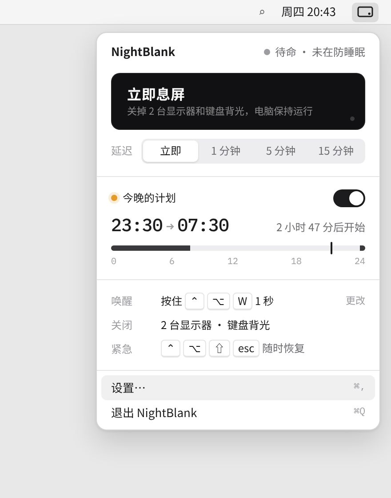
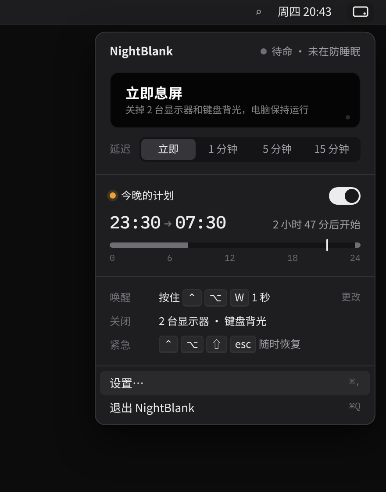
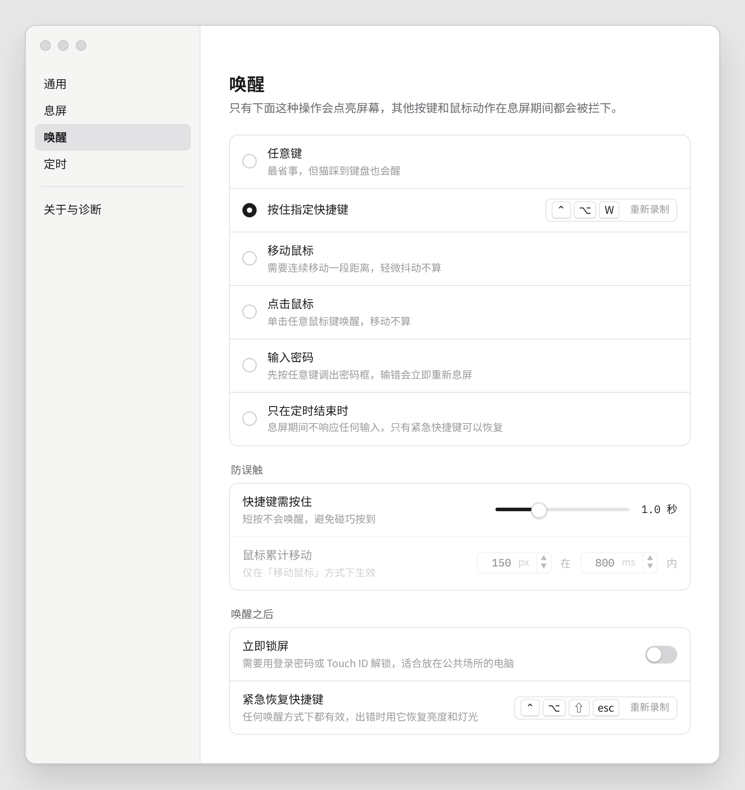
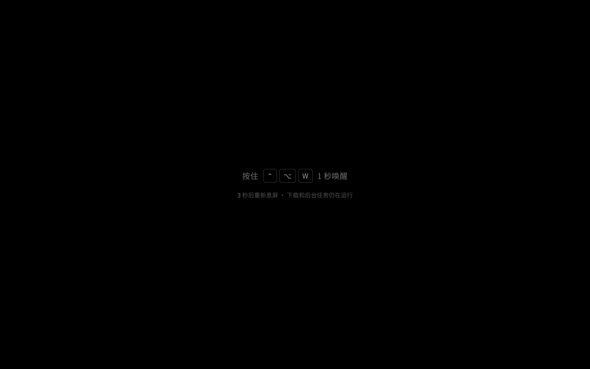
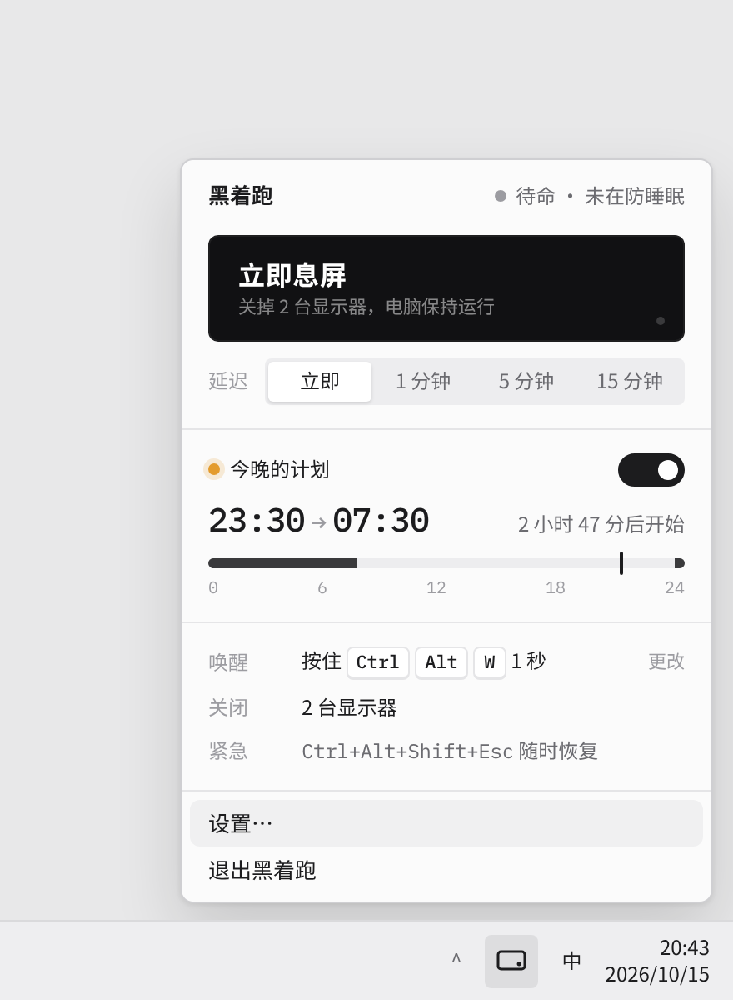
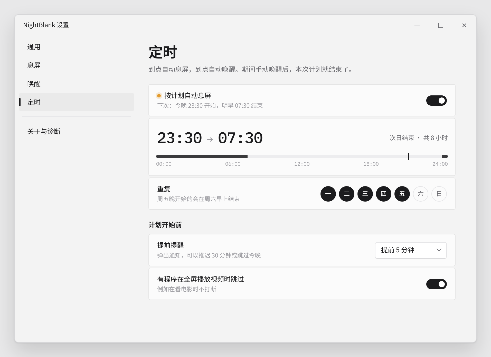

<p align="center"></p>

<h1 align="center">息屏跑 BlankRun</h1>

<p align="center">夜里关掉屏幕和灯，让 AI 接着跑。<br>Turn the screens off at night. Keep your AI agents running.</p>

<p align="center"><a href="https://blankrun.cosfoc.com">官网 Website</a> · <a href="https://github.com/hongfaqiu/blankrun/releases">Releases</a> · macOS + Windows · MIT</p>

> **状态：早期开发中，还没有在真机上测试过，暂无可下载的安装包。**
> **Status: early development. Not yet tested on real hardware. No downloadable build yet.**

<p align="center"> </p>

## 这是什么

睡前给 Claude Code、Codex 或本地模型布置好一晚上的任务，顺便挂着编译和下载。可屏幕亮一整夜太刺眼，让电脑睡眠任务又会断。

息屏跑常驻在菜单栏（Windows 上是托盘），一键把屏幕真正关掉，同时阻止系统睡眠，让任务继续跑。息屏期间它会拦下误触，只认你设定的唤醒方式。

计划中的功能如下，代码已写，**尚未在真机上验证**：

- **立即息屏 / 倒计时息屏**：可以立即息屏，也可以延迟 1、5、15 分钟。
- **息屏时防睡眠**：macOS 用 IOPMAssertion，Windows 用 SetThreadExecutionState。
- **定时计划**：例如每天 23:30 到 07:30，支持跨午夜，也可以跳过今晚。
- **可配置唤醒**：任意键、按住快捷键（默认 ⌃⌥W 按住 1 秒）、移动鼠标、点击、唤醒后锁屏输密码，或者只在定时结束时唤醒；另有一个紧急恢复快捷键。
- **防误触**：息屏期间拦截键鼠输入；屏幕被意外点亮时，几秒内自动再关。
- **键盘背光**：macOS 上一起关掉。用的是私有接口，运行时先探测，不可用时自动跳过。
- **Windows Modern Standby**：检测到关屏会让机器进入低功耗待机的机型时，改用全黑遮罩，避免任务被挂起。
- **体积小**：基于 Tauri 2，前端零依赖。目标是 Windows 安装包 ≤ 3 MB、macOS DMG ≤ 4 MB（尚未实测）。
- **本地运行**：不联网，不上传。

后续版本：外接显示器断电（DDC/CI）、RGB 灯控制、开机启动、全局快捷键、开始前提醒、全屏视频时跳过定时。

## What is it

You queue up a night of work for Claude Code, Codex or a local model, plus a build and some downloads. The screen shouldn't glow all night, but letting the computer sleep would stop the jobs.

BlankRun lives in the menu bar (system tray on Windows). One click really turns the displays off while blocking system sleep, so jobs keep running. While the screen is off it swallows accidental input and only wakes the way you choose: any key, hold a hotkey, mouse move, click, password, or only when the schedule ends. It also handles schedules, keyboard backlight on macOS, auto re-blank, and a fallback for Windows Modern Standby. It is built with Tauri 2, aims for a tiny binary and runs fully offline.

All of this is written but **not yet verified on real hardware**. Expect rough edges.

## 截图 Screenshots

| 设置 · 唤醒 | 息屏中 | 首次引导 |
|---|---|---|
|  |  |  |

| Windows 托盘面板 | 设置 · 定时 (Windows) |
|---|---|
|  |  |

截图都是设计稿渲染出来的，真机上字体会更接近系统原生。

## 文档

- [DESIGN.md](DESIGN.md)：设计文档
- [RESEARCH.md](RESEARCH.md)：调研与规划
- [design/](design/)：界面设计稿与设计卡
- [site/](site/)：官网源文件（静态 HTML/CSS）

## 目录结构
```
Cargo.toml              workspace + 体积优先的 release profile
crates/core/            平台无关核心（可在任何主机 cargo test）
  src/state.rs          状态机 Idle → Armed → ScreenOff → Waking，输出 Action
  src/config.rs         config.toml 结构（DESIGN.md §3），全部字段有默认值
  src/schedule.rs       定时计划（跨午夜、距下次开始、开始/结束边沿 + 跳过今晚）
  src/wake.rs           唤醒策略 / 防误触（按住快捷键、鼠标累计位移、紧急键）
  src/hotkey.rs         "Ctrl+Alt+W" 解析与匹配
src-tauri/              Tauri 2 托盘/菜单栏应用
  src/main.rs           托盘与弹出面板、窗口、Tauri 命令（配置、息屏、诊断、权限）
  src/engine.rs         引擎线程：状态机 + 倒计时 + 定时 + 唤醒策略 + 遮罩窗口 + 意外点亮后重新息屏
  src/platform/mod.rs   Platform trait、输入事件通道
  src/platform/macos.rs   IOPMAssertion、IORequestIdle/pmset、CoreBrightness 背光（运行时探测）、CGEventTap（未在真机测试）
  src/platform/windows.rs SetThreadExecutionState、SC_MONITORPOWER、Modern Standby 检测、显示器状态回调、LL 键鼠钩子
  src/platform/stub.rs  其他平台 no-op，仅供编译检查
ui/                     正式界面：原生 HTML/JS/CSS，无框架、无打包器、无内联样式（CSP）
  popover / settings / overlay / onboarding .html + 各自的 .js/.css，共享 nb.css、common.js
site/                   官网（静态 HTML/CSS）；push 到 main 后由 Cloudflare Pages（项目 blankrun-site）自动部署到 blankrun.cosfoc.com
design/                 设计稿；design/preview/ 用假的 __TAURI__ 在 Chrome 里渲染 ui/ 检查布局
```
配置文件位置：系统应用配置目录下的 `com.cosfoc.blankrun/config.toml`。

## 体积目标
| 产物 | 目标 |
|---|---|
| Windows 安装包（NSIS, lzma，WebView2 用系统自带） | ≤ 3 MB |
| macOS DMG | ≤ 4 MB |
| 主程序（单架构） | ≤ 5 MB |

手段：`opt-level="z"`、`lto`、`codegen-units=1`、`panic="abort"`、`strip`；Tauri 关闭默认特性只留 `wry`/`tray-icon`/`compression`；
Windows 用 `windows-sys` 而非 `windows`；核心不用 chrono/regex/tokio 等重依赖；前端零依赖。新增 crate 前请先评估体积。

## 开发
```
cargo test -p blankrun-core                              # 核心单测，任意平台
cargo check -p blankrun --target x86_64-pc-windows-gnu   # 在 Linux 上检查 Windows 代码
cargo install tauri-cli --version "^2" && cargo tauri build  # 在 Mac / Windows 本机打包
```
macOS 目标只能在 Mac（或 CI 的 macOS runner）上构建。Linux 上可以做类型检查（不链接）：
```
rustup target add aarch64-apple-darwin
# objc2-exception-helper 的构建脚本要编译 .m 文件，用一个只产生空目标文件的假 cc 绕过（只用于 check）
CC_aarch64_apple_darwin=$PWD/tools/fake-cc.sh AR_aarch64_apple_darwin=ar cargo check -p blankrun --target aarch64-apple-darwin
```
界面预览：`NODE_PATH=<含 playwright-core 的 node_modules> node design/preview/render.mjs`，输出到 `design/preview/out/`。

## License

[MIT](LICENSE) © 2026 COSFOC / hongfaqiu
