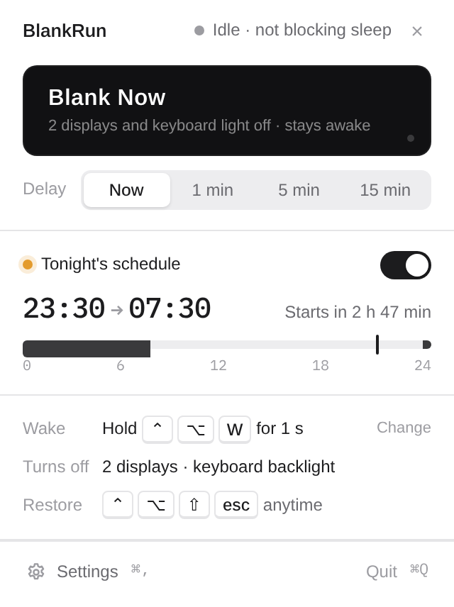
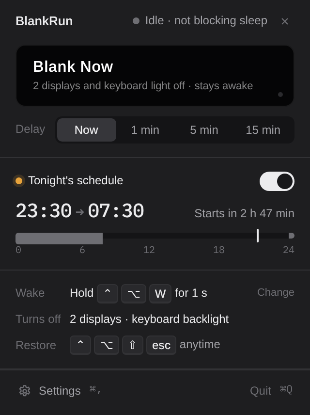
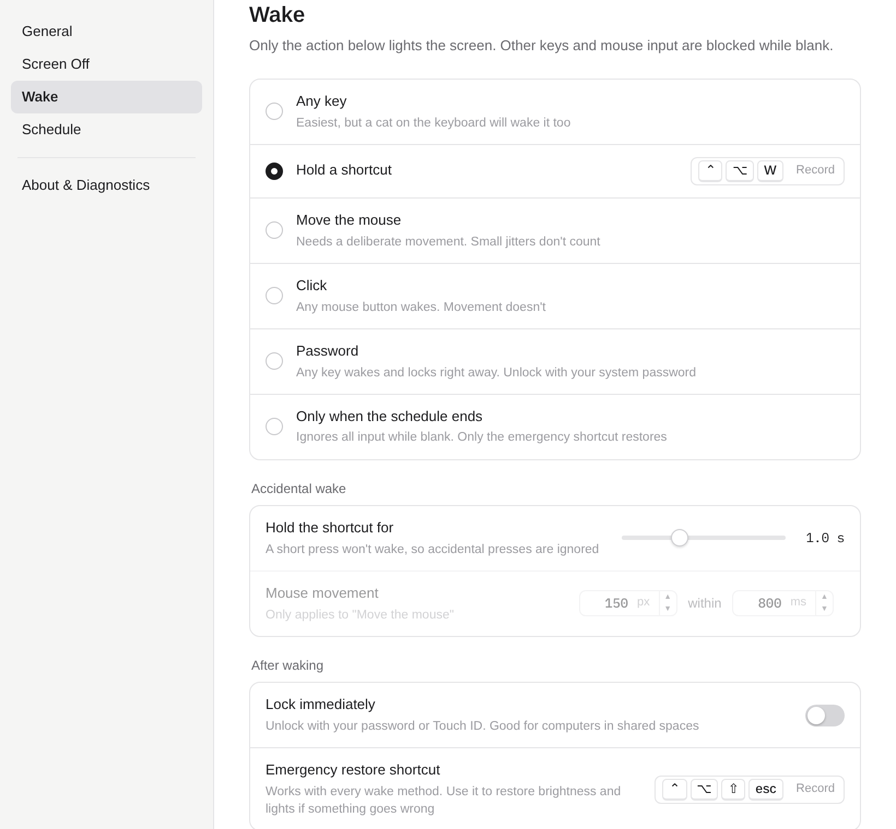
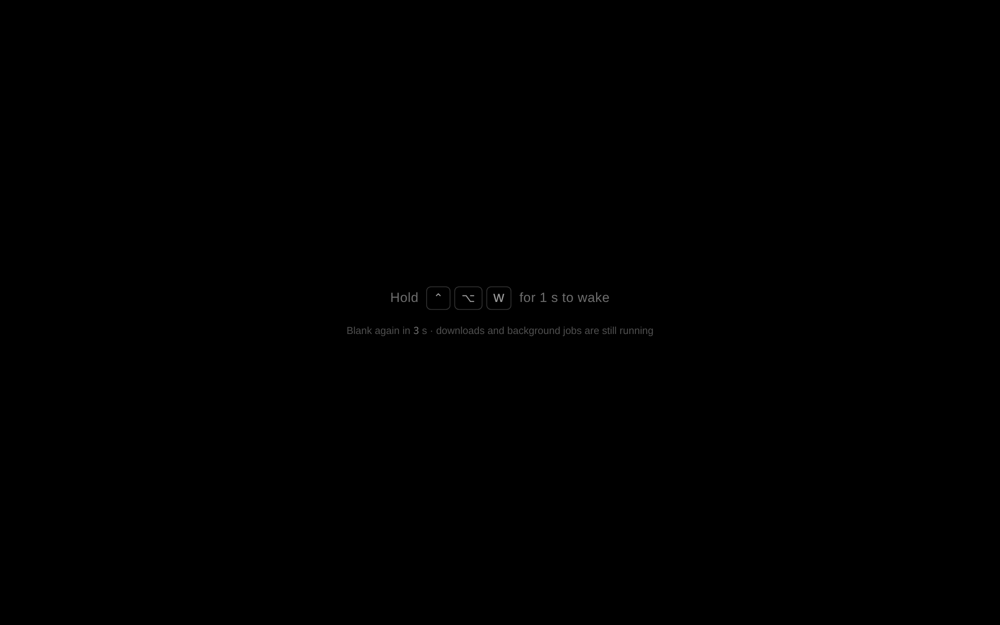
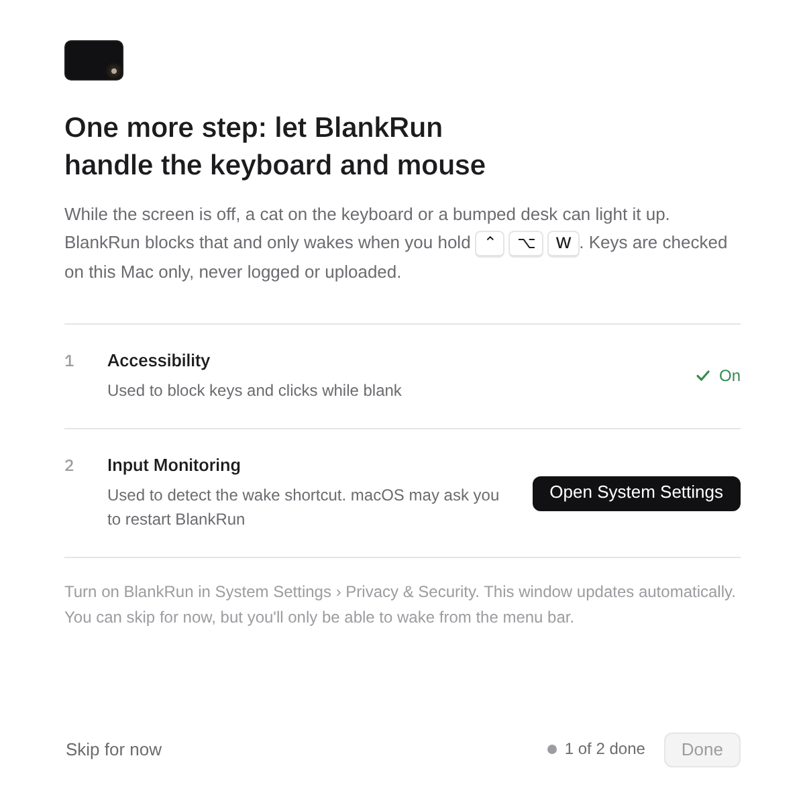
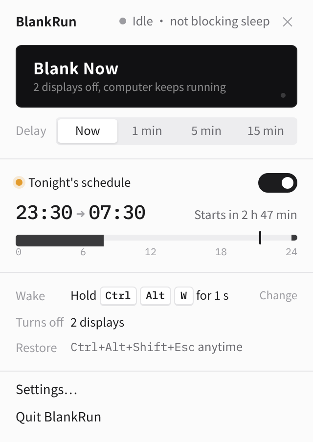
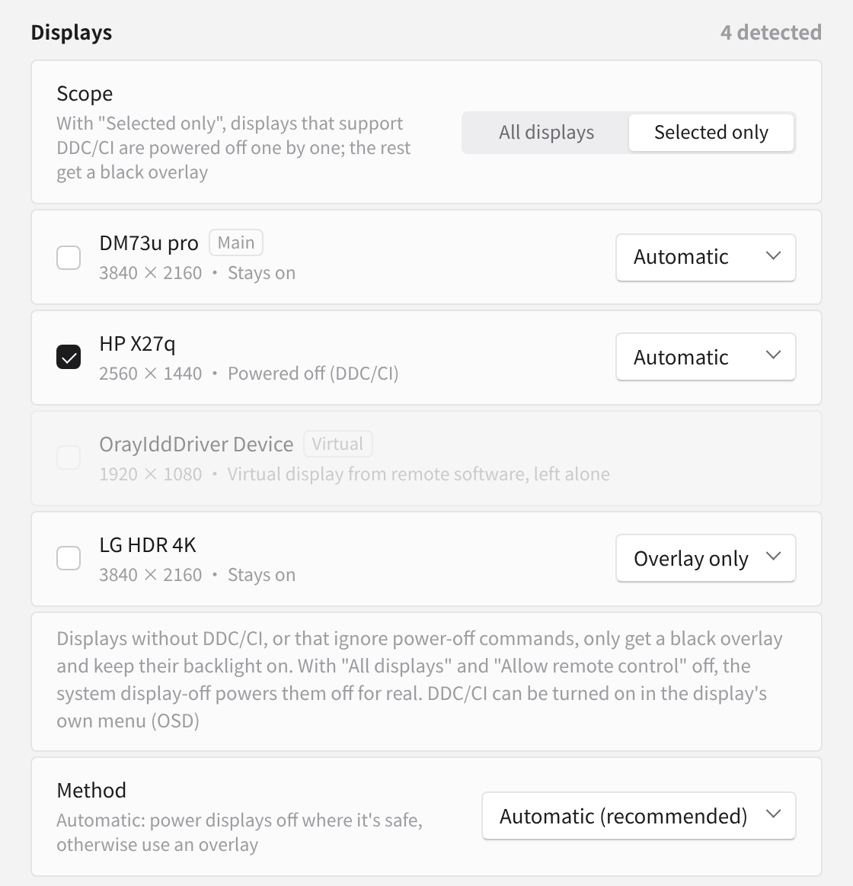
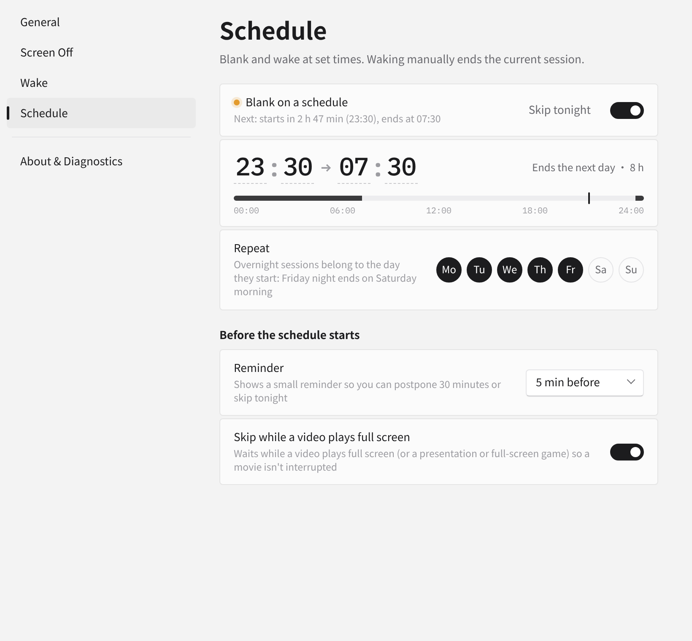

<p align="center"></p>

<h1 align="center">BlankRun · 黑着跑</h1>

<p align="center">Turn the screens off at night. Keep your AI agents running.</p>

<p align="center"><b>English</b> · <a href="README.zh-CN.md">简体中文</a></p>

<p align="center"><a href="https://blankrun.cosfoc.com">Website</a> · <a href="https://github.com/hongfaqiu/blankrun/releases">Download</a> · macOS + Windows · MIT</p>

> **Latest version: v0.1.8** · macOS 11+ (Apple silicon and Intel) · Windows 10/11 x64 · [Download](https://github.com/hongfaqiu/blankrun/releases/latest). The macOS app is signed with a Developer ID and notarized by Apple, so it opens with a double-click; see the [website](https://blankrun.cosfoc.com/#download) for first-launch steps.

<p align="center"> </p>

## What it is

You queue up a night of work for Claude Code, Codex or a local model, plus a build and some downloads. A screen glowing all night is too bright, but letting the computer sleep stops the jobs.

BlankRun lives in the menu bar (the notification area on Windows). One click really turns the displays off and blocks system sleep, so your jobs keep running. While the screen is off, it ignores accidental input and only wakes the way you chose.

Features:

- **Blank now or after a delay**: right away, or after 1, 5 or 15 minutes.
- **No sleep while blank** (on by default, can be turned off): IOPMAssertion on macOS, SetThreadExecutionState on Windows.
- **Schedule**: for example 23:30 to 07:30 every day. Works across midnight, and you can skip just tonight.
- **Configurable wake**: any key, holding a shortcut (⌃⌥W for 1 second by default), moving the mouse, clicking, locking on wake so you enter your password, or only when the schedule ends. A separate emergency shortcut always restores everything. After a shortcut wake, the keyboard stays blocked until the keys are released (at most 2 seconds), so key repeats never reach the app in front; the mouse works right away.
- **No accidental wake**: keyboard and mouse input is blocked while blank. If the screen lights up anyway, it goes dark again within seconds. On macOS without Accessibility permission, the wake shortcut still works and stray touches are re-blanked.
- **macOS permissions**: if Accessibility or Input Monitoring isn't granted, BlankRun asks for it once per launch (also when it starts quietly in the menu bar) with the system prompt (`AXIsProcessTrustedWithOptions` with `kAXTrustedCheckOptionPrompt`, `CGRequestListenEventAccess`). Settings › About & Diagnostics refreshes the permission status every 1.5 seconds, so it turns green without a restart. If the switch in System Settings looks on but BlankRun still says not granted, it's usually a stale entry from an older version with a different signature (versions up to 0.1.6 were ad-hoc signed): remove it with "−" in System Settings, or click **Reset and ask again** (`tccutil reset Accessibility com.cosfoc.blankrun` and `tccutil reset ListenEvent com.cosfoc.blankrun`, then ask again). A **Restart BlankRun** button is there for permissions that only take effect after a restart.
- **Launch at login, blank-now shortcut** (⌃⌥B by default), **a reminder before the schedule starts** (skip tonight or postpone 30 min), and **waiting while a video plays full screen**.
- **Per-display power-off**: on Windows, displays with DDC/CI are powered off one by one and the rest get a black overlay. Each display can be set to Automatic, Overlay only or Power off, and displays that ignore power-off commands are detected automatically. On a Mac, the built-in display is disconnected the way closing the lid does it (panel powered down), or its backlight goes to 0 where that isn't available. Virtual displays from remote tools are left alone. See below.
- **Allow remote control**: input from remote tools passes through without waking the local screens, and the remote view keeps a live picture. BlankRun doesn't blank inside a Remote Desktop (RDP) session.
- **Keep using keyboard & mouse ("Mac mini mode")**: with "Selected only", turn off just the MacBook's built-in screen and keep working on the external display with the local keyboard, mouse and trackpad. See below.
- **Keyboard backlight**: turned off together with the screen on macOS. It uses a private API that is probed at runtime and skipped when unavailable.
- **Windows Modern Standby**: on PCs that drop into low-power standby when the display turns off, BlankRun uses a black overlay instead so jobs aren't suspended.
- **English and Chinese UI**: follows the system language by default. Switch in Settings › General › Language and the tray menu, wake hints and onboarding update immediately, with no restart.
- **Small**: built on Tauri 2 with a zero-dependency UI. v0.1.8: 1.4 MB Windows installer, 3.7 MB universal macOS DMG.
- **Auto-update**: checks once a day (can be turned off). Updates are signed, downloads retry on network errors, and an update installs only when you click "Update and restart", never while the screen is blank. From v0.1.1 on; v0.1.0 needs one manual install.
- **Blank history**: the last 30 sessions with time, trigger, how they ended and how many accidental touches were blocked. Stored locally and can be cleared.
- **Local only**: apart from the daily update check, nothing goes over the network and nothing is uploaded.

Later versions: RGB lighting, external display power-off on macOS.

## Per-display power-off and remote control

- **Windows**: displays that support DDC/CI (turn it on in the display's own OSD menu) are powered off one by one with VCP 0xD6 = 4 and back on with 1, so "Selected only" and remote-control mode can still cut the backlight. Displays without DDC/CI get a black overlay. Every few seconds BlankRun re-reads 0xD6 and powers a display off again if something lit it. While blanked, the black overlay stays on top too, so a failed DDC write still leaves the screen black. DDC/CI calls are slow (tens of ms each) and some displays ignore 0xD6 or lose their DisplayPort link in standby, which can make Windows rearrange windows.
- **Per-display override**: each display can be set to Automatic, Overlay only, or Power off (when supported). A display that accepts the DDC/CI power-off command but stays lit (it reads "on" twice while blanked) is remembered as overlay-only, so BlankRun stops sending it power-off commands and it doesn't flicker. With "All displays" (or every physical display selected), remote control off and no display set to overlay only, BlankRun uses the system-wide display-off, which also really powers off displays without working DDC/CI.
- **macOS**: when another physical display is on, the built-in display is **disconnected** with SkyLight's private `SLSConfigureDisplayEnabled` — the same mechanism as closing the lid, BetterDisplay's "Disconnect display" and Lunar's BlackOut. The panel is powered down (no pixels lit, which matters for OLED), it disappears from System Settings › Displays, and its windows move to the other displays; macOS may re-apply the arrangement/resolution it remembers for the remaining set of displays. This needs Apple silicon and macOS 13 or later, no extra permissions and no SIP changes. Setting: Settings › Screen Off › Built-in display (`[display] builtin_off` = `"auto"` / `"disconnect"` / `"backlight"`). `"auto"` doesn't disconnect on M3-family Macs (some only reconnect after a restart) or iMacs (no lid to recover with). Recovery: BlankRun reconnects the display on wake, on the emergency shortcut, on quit, in the panic handler, at the next launch after a crash (it's written to the crash marker), and by itself if the other displays go away for 3 seconds (macOS doesn't do that on its own). It's never disconnected when it's the only display, and if macOS reconnects it (sleep/wake, lid) it's disconnected again. If BlankRun is killed hard and not reopened, closing and opening the lid, logging out or restarting brings the display back. Where disconnecting isn't available or fails (Intel, older macOS, built-in is the only screen), the backlight is turned to 0 through DisplayServices plus a black overlay, restored on wake or next launch. External displays get a black overlay for now.
- **Built-in display test** (macOS, Settings › Screen Off › Built-in display › Test): with another physical display connected, BlankRun disconnects the built-in display for about 3 seconds after a confirmation, checks with `CGGetActiveDisplayList`/`CGDisplayIsActive` that it really went away, reconnects it (several attempts with timeouts) and checks that it came back. The result is one of: can truly disconnect, not supported (Intel, older macOS or the private API is missing; backlight + overlay only), or didn't come back (close and open the lid, or restart). It's saved in `[display.builtin_test]` with the model (`hw.model`), chip and macOS version. With `builtin_off = "auto"`, a passed test on the same model, chip and major macOS version allows disconnecting (M3 Macs and iMacs included), a failed test turns it off, and an untested Mac keeps the default rule. The crash marker is written before the test disconnects anything, so a crash mid-test reconnects the display at the next launch. The result also shows in Settings › About & Diagnostics.
- **Virtual displays** from remote tools (Sunlogin/Oray IDD, Parsec, Virtual Desktop, IddCx, spacedesk, ToDesk, RustDesk …) are recognized by adapter or display name and never covered or powered off.
- **Allow remote control** (off by default): synthesized input (Windows `LLKHF_INJECTED`/`LLMHF_INJECTED`, macOS events whose source PID ≠ 0) passes straight through and never counts as a touch or a wake. The local screens stay off, and system-wide display-off is never used in this mode, so the remote session keeps a live picture. Once a display is confirmed off via DDC/CI (it reads standby), its overlay is removed, because remote tools capture the GPU framebuffer and would otherwise see the black overlay; it goes back if the display lights up again. Displays that only get an overlay look black remotely too, so point the remote client at a DDC-powered-off display or a virtual display. Trade-off: keys and clicks simulated by any other app (macros, on-screen keyboards, malware) are not blocked either.
- **Keep using keyboard & mouse** (Settings › Screen Off, `[display] keep_input`, off by default): for using a MacBook like a Mac mini. With "Selected only" and at least one physical display left unselected, local input goes straight to your apps and never counts as a touch or a wake. The selected displays stay dark (the built-in is disconnected, see macOS above; with the backlight fallback it's backlight 0 plus overlay, turned back to 0 if the brightness keys or auto-brightness raise it) and the cursor is kept off them. Only holding the wake shortcut, the emergency shortcut, the menu bar / tray menu or the end of the schedule bring them back; "any key", mouse and click wake methods act as the wake shortcut here. The system-wide display-off is never used in this mode (it would turn off the external display too), and the keyboard backlight is left on. Tip: make the external display the main display in System Settings › Displays so new windows and the menu bar open there. Lid-closed (clamshell) use is not covered. Works the same on Windows.
- **Remote Desktop (RDP)**: BlankRun doesn't blank inside an RDP session, and it wakes if one starts while blanked, because overlays and input blocking would land on the remote user's screen.

## Screenshots

| Settings · Wake | Screen off | First-run setup |
|---|---|---|
|  |  |  |

| Windows tray panel | Settings · Displays (Windows) | Settings · Schedule (Windows) |
|---|---|---|
|  |  |  |

Screenshots are rendered from the app's UI. On your machine, fonts follow the system.

## Docs

- [DESIGN.md](DESIGN.md): design document (Chinese)
- [RESEARCH.md](RESEARCH.md): research and plan (Chinese)
- [design/](design/): UI mockups and design card
- [site/](site/): website source (static HTML/CSS)

## Layout
```
Cargo.toml              workspace + size-first release profile
crates/core/            platform-independent core (cargo test on any host)
  src/state.rs          state machine Idle → Armed → ScreenOff → Waking, emits Actions
  src/config.rs         config.toml schema (DESIGN.md §3); every field has a default
  src/schedule.rs       schedule (across midnight, time until next start, start/end edges, skip tonight)
  src/wake.rs           wake policy and accidental-wake guard (hold shortcut, mouse distance, emergency key)
  src/hotkey.rs         "Ctrl+Alt+W" parsing and matching
  src/locale.rs         UI language choice (match system or explicit; same rules as ui/common.js)
  src/monitors.rs       per-display plan: power off, overlay or skip (virtual displays, overrides, remote mode)
  src/drain.rs          keyboard drain after a shortcut wake (held keys, 300 ms grace, 2 s cap)
src-tauri/              Tauri 2 tray / menu bar app
  src/main.rs           tray and panel, windows, Tauri commands (config, blank, diagnostics, permissions, locale)
  src/engine.rs         engine thread: state machine, countdown, schedule, wake policy, overlays, re-blank
  src/platform/mod.rs   Platform trait, input event channel
  src/platform/macos.rs   IOPMAssertion, IORequestIdle/pmset, CoreBrightness keyboard backlight (probed), DisplayServices brightness, SkyLight display disconnect (probed), CGEventTap
  src/platform/windows.rs SetThreadExecutionState, SC_MONITORPOWER, Modern Standby detection, display-state callback, LL hooks
  src/platform/win_monitors.rs display enumeration, DDC/CI (VCP 0xD6) power
  src/platform/stub.rs  no-op for other platforms, compile checks only
ui/                     the real UI: plain HTML/JS/CSS, no framework, no bundler, no inline styles (CSP)
  popover / settings / overlay / onboarding .html + their .js/.css, shared nb.css and common.js
  i18n/<code>.js        UI strings (en, zh-CN), one file per language
site/                   website (static HTML/CSS); pushes to main auto-deploy via Cloudflare Pages (project blankrun-site) to blankrun.cosfoc.com
design/                 mockups; design/preview/ renders ui/ in Chrome with a fake __TAURI__ to check layouts
docs/screenshots/       screenshots used in the READMEs
```
Config file: `com.cosfoc.blankrun/config.toml` in the system app-config directory.

## Size targets
| Artifact | Target |
|---|---|
| Windows installer (NSIS, lzma, system WebView2) | ≤ 3 MB |
| macOS DMG | ≤ 4 MB |
| Main binary (single arch) | ≤ 5 MB |

How: `opt-level="z"`, `lto`, `codegen-units=1`, `panic="abort"`, `strip`; Tauri default features off, keeping only `wry`/`tray-icon`/`compression`;
`windows-sys` instead of `windows`; no chrono/regex/tokio in the core; zero frontend dependencies. Check the size impact before adding a crate.

## Development
```
cargo test -p blankrun-core                              # core tests, any platform
cargo check -p blankrun --target x86_64-pc-windows-gnu   # check the Windows code on Linux
cargo install tauri-cli --version "^2" && cargo tauri build  # package on a Mac / Windows machine
```
macOS targets only build on a Mac (or a macOS CI runner). On Linux you can type-check without linking:
```
rustup target add aarch64-apple-darwin
# objc2-exception-helper's build script compiles a .m file; a fake cc that emits an empty object works around it (check only)
CC_aarch64_apple_darwin=$PWD/tools/fake-cc.sh AR_aarch64_apple_darwin=ar cargo check -p blankrun --target aarch64-apple-darwin
```
UI preview: `NODE_PATH=<node_modules with playwright-core> node design/preview/render.mjs` renders both languages to `design/preview/out/`.

Logs: `blankrun.log` next to `config.toml`. For scripted tests: `blankrun --blank-now[=delay_s] --wake-after=s --quit-after=s` (on macOS: `open -n -a BlankRun --args …`).

Releases: pushing a `v*` tag runs `.github/workflows/release.yml`, which builds a universal macOS DMG and a Windows NSIS installer and publishes a GitHub Release (tags with `-` become pre-releases). Running the workflow manually builds without publishing. When the `APPLE_CERTIFICATE*` and `APPLE_API_*` secrets are set, the macOS app is signed with a Developer ID, notarized and stapled, and the DMG is signed (notarizing the DMG too is optional: the `notarize_dmg` input or the `NOTARIZE_DMG` repo variable); without the secrets the build falls back to an ad-hoc signature.

## Adding a UI language

1. Copy `ui/i18n/en.js` to `ui/i18n/<code>.js` (for example `ja.js` or `zh-TW.js`). Change `NB_LOCALE("en", …)` and `"_name"` to the new code and the language's own name (for example "日本語").
2. Translate the strings. Anything left out falls back to English. `.mac` / `.win` suffixes are platform-specific variants, `{n}` and similar are placeholders, and `{ "one": …, "other": … }` are plural forms.
3. Rebuild. `build.rs` scans `ui/i18n/`, so the language shows up in Settings › General › Language, and "Match system" picks it automatically.

Before the UI loads, the tray menu uses `tray_text` in `src-tauri/src/main.rs` (Chinese and English). Once the UI loads it switches to the `tray.*` strings from the locale file, so a new language needs no Rust changes.

## License

[MIT](LICENSE) © 2026 COSFOC / hongfaqiu
