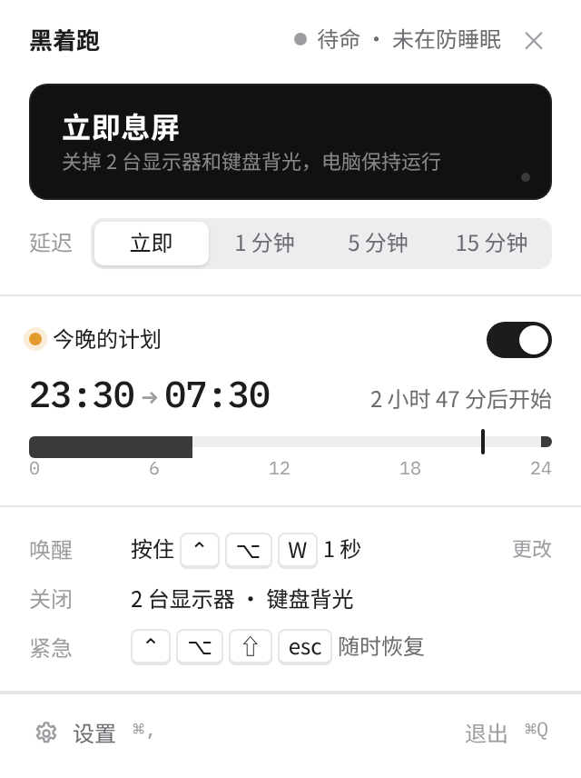
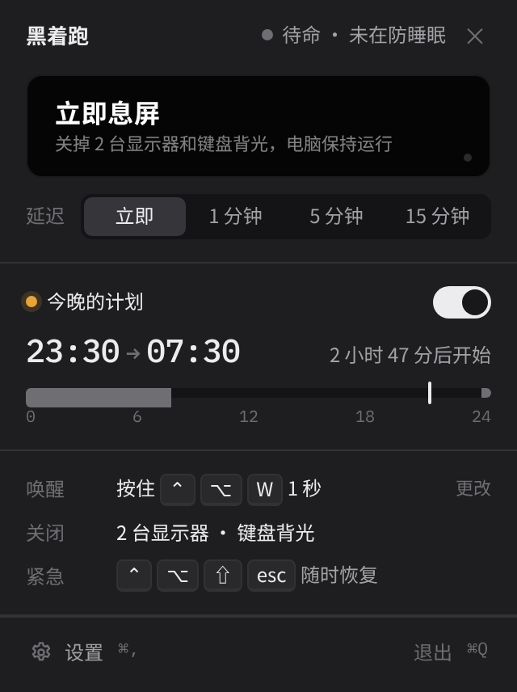
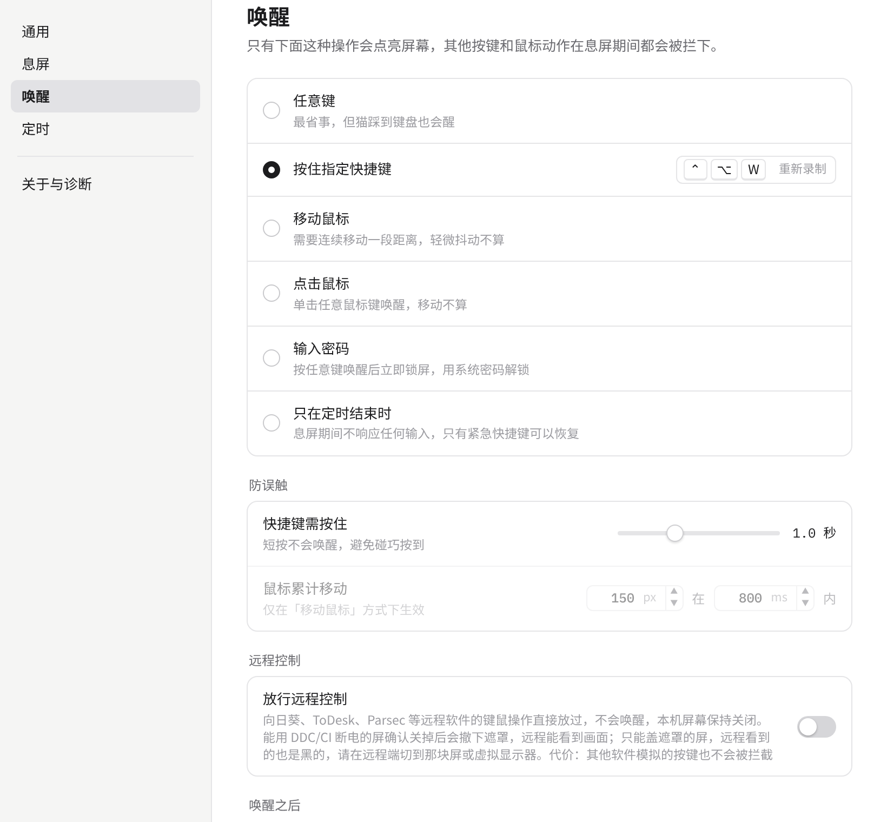
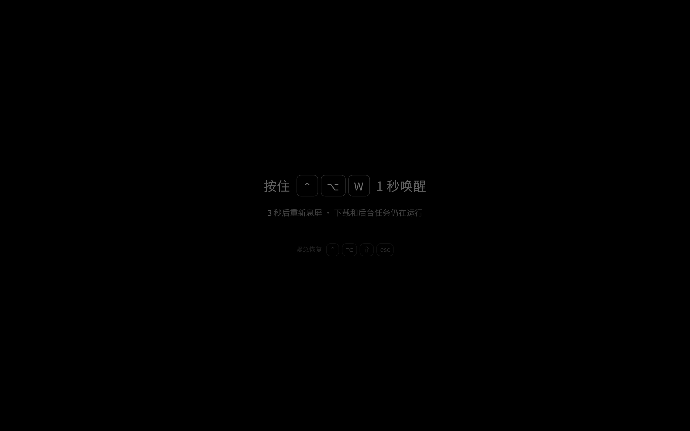
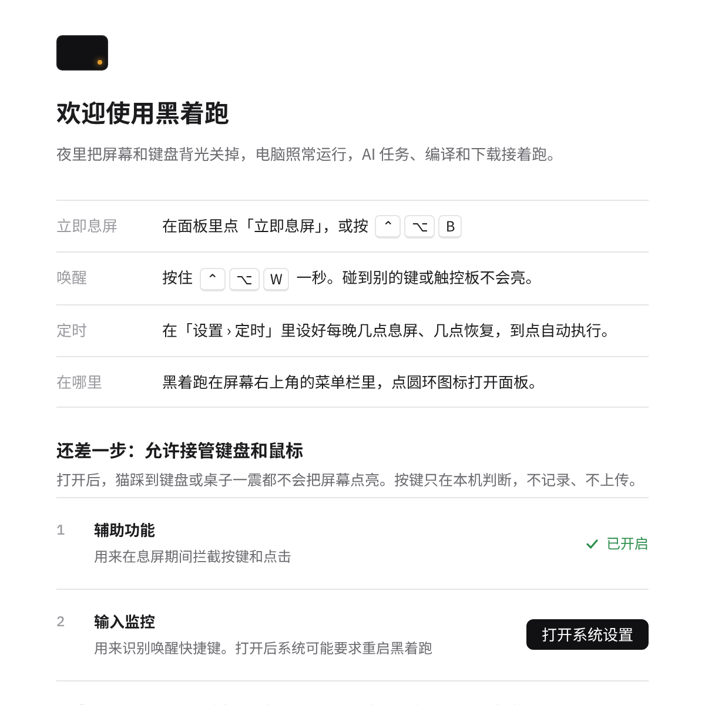
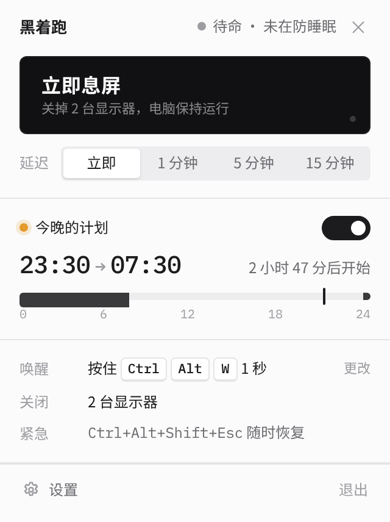
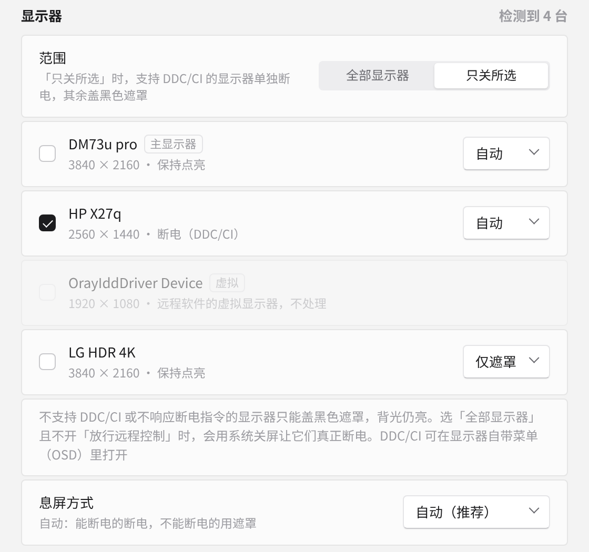

<p align="center"></p>

<h1 align="center">BlankRun · 黑着跑</h1>

<p align="center">夜里关掉屏幕和灯，让 AI 接着跑。</p>

<p align="center"><a href="README.md">English</a> · <b>简体中文</b></p>

<p align="center"><a href="https://blankrun.cosfoc.com">官网</a> · <a href="https://github.com/hongfaqiu/blankrun/releases">下载</a> · macOS + Windows · MIT</p>

> **最新版本：v0.1.7** · macOS 11+（Apple 芯片与 Intel）· Windows 10/11 x64 · [下载](https://github.com/hongfaqiu/blankrun/releases/latest)。macOS 版已用 Developer ID 签名并通过 Apple 公证，双击即可打开；首次打开的步骤见[官网](https://blankrun.cosfoc.com/#download)。

<p align="center"> </p>

## 这是什么

睡前给 Claude Code、Codex 或本地模型布置好一晚上的任务，顺便挂着编译和下载。可屏幕亮一整夜太刺眼，让电脑睡眠任务又会断。

黑着跑常驻在菜单栏（Windows 上是托盘），一键把屏幕真正关掉，同时阻止系统睡眠，让任务继续跑。息屏期间它会拦下误触，只认你设定的唤醒方式。

功能如下：

- **立即息屏 / 倒计时息屏**：可以立即息屏，也可以延迟 1、5、15 分钟。
- **息屏时防睡眠**（默认开，可关）：macOS 用 IOPMAssertion，Windows 用 SetThreadExecutionState。
- **定时计划**：例如每天 23:30 到 07:30，支持跨午夜，也可以跳过今晚。
- **可配置唤醒**：任意键、按住快捷键（默认 ⌃⌥W 按住 1 秒）、移动鼠标、点击、唤醒后锁屏输密码，或者只在定时结束时唤醒；另有一个紧急恢复快捷键。按住快捷键唤醒后，键盘会继续拦截到按键全部松开（最多 2 秒），自动重复不会漏进前台程序；鼠标立即可用。
- **防误触**：息屏期间拦截键鼠输入；屏幕被意外点亮时，几秒内自动再关。macOS 没给辅助功能权限时，唤醒快捷键照样能用，误触点亮后也会自动再熄灭。
- **开机启动、立即息屏快捷键**（默认 ⌃⌥B）、**定时开始前提醒**（可跳过今晚或推迟 30 分钟）、**全屏看视频时先等着**。
- **逐台断电**：Windows 上支持 DDC/CI 的显示器单独断电，其余盖黑色遮罩；每台可选「自动 / 仅遮罩 / 断电」，不响应断电指令的显示器会被自动识别。Mac 内建屏像合盖一样「断开」（面板断电），不支持时退回背光调到 0。远程软件的虚拟显示器不遮、不断电。详见下文。
- **放行远程控制**：远程软件的键鼠操作直接放行，不会唤醒本机屏幕，远程画面照常可见。远程桌面（RDP）会话中不息屏。
- **键鼠照常用（Mac mini 模式）**：配合「只关所选」，只关 MacBook 内建屏，外接屏照常亮着，本机键盘、鼠标、触控板照常用。详见下文。
- **键盘背光**：macOS 上一起关掉。用的是私有接口，运行时先探测，不可用时自动跳过。
- **Windows Modern Standby**：检测到关屏会让机器进入低功耗待机的机型时，改用全黑遮罩，避免任务被挂起。
- **中英双语界面**：默认跟随系统语言，也可以在「设置 › 通用 › 语言」里切换，托盘菜单、息屏提示和首次引导都会立即换过来，不用重启。
- **体积小**：基于 Tauri 2，前端零依赖。v0.1.7：Windows 安装包 1.4 MB，macOS 通用版 DMG 3.7 MB。
- **自动更新**：每天检查一次（可关）。更新包有签名校验，下载失败会自动重试，只在你点「更新并重启」时安装，息屏中不会更新。从 v0.1.1 开始支持，v0.1.0 需要手动装一次。
- **息屏记录**：保留最近 30 次的时间、触发方式、结束方式和拦下的误触次数，只存在本机，可一键清空。
- **本地运行**：除了每天一次检查更新，不联网，不上传任何数据。

后续版本：RGB 灯控制、macOS 外接显示器断电。

## 逐台断电与远程控制

- **Windows**：支持 DDC/CI 的显示器（需在显示器自带 OSD 菜单里打开）用 VCP 0xD6 = 4 单独断电，唤醒时写 1，所以「只关所选」和远程控制模式下也能真的关掉背光；不支持的用黑色遮罩。息屏期间每几秒读一次 0xD6，被点亮就再关；黑色遮罩始终也盖着，DDC 写失败屏幕仍是黑的。DDC/CI 每次调用几十毫秒；个别显示器不认 0xD6，或者 DP 接口待机后断开连接，导致 Windows 重排窗口。
- **逐台指定**：每台显示器可选「自动 / 仅遮罩 / 断电（支持时）」。接受 DDC/CI 断电指令却仍亮着的显示器（息屏期间两次读到「开」）会被记成仅遮罩，之后不再发断电指令，避免闪烁。选「全部显示器」（或选中了全部物理屏）、未开「放行远程控制」、也没有设成仅遮罩的屏时，用系统级关屏，不支持 DDC/CI 的显示器也能真正断电。
- **macOS**：还有别的物理屏亮着时，内建屏用 SkyLight 私有接口 `SLSConfigureDisplayEnabled` **断开**——和合盖、BetterDisplay 的「断开显示器」、Lunar 的 BlackOut 是同一个机制。面板断电（像素全灭，对 OLED 有意义），从「系统设置 › 显示器」里消失，上面的窗口挪到别的屏；macOS 可能按它记住的「剩下这几块屏」的排列 / 分辨率重新摆一次。需要 Apple 芯片、macOS 13 起；不需要额外权限，也不用关 SIP。设置：设置 › 息屏 › 内建屏（`[display] builtin_off` = `"auto"` / `"disconnect"` / `"backlight"`）。`"auto"` 在 M3 系列（部分机型断开后要重启才能接回）和 iMac（没有盖子可以开合救回）上不断开。恢复：唤醒、紧急快捷键、退出、程序 panic、崩溃后下次启动（写在崩溃标记里），以及别的屏连续 3 秒都没了（比如拔掉外接屏，macOS 自己不会接回）时，黑着跑都会把内建屏接回来。只剩内建屏时绝不断开；被系统接回来（休眠唤醒、开合盖）会再断开。如果黑着跑被强杀又没再打开：合上再打开盖子、注销或重启都能让内建屏回来。不能断开或断开失败时（Intel、老系统、只剩内建屏）退回 DisplayServices 背光调 0 + 黑色遮罩，唤醒（或崩溃后下次启动）时恢复。外接显示器暂时只盖黑色遮罩。
- **虚拟显示器**（向日葵/Oray IDD、Parsec、Virtual Desktop、IddCx、spacedesk、ToDesk、RustDesk 等）按显卡/显示器名称识别，永远不遮、不断电。
- **放行远程控制**（默认关）：合成输入（Windows `LLKHF_INJECTED`/`LLMHF_INJECTED`，macOS 事件来源 PID ≠ 0）直接放过，不算碰到也不唤醒；本机屏幕保持关闭，且这个模式下不用系统级关屏，远程画面不受影响。确认已用 DDC/CI 断电（读到待机）的屏会撤下遮罩——远程软件抓的是显卡画面，遮罩在远程看来也是黑的；屏幕再被点亮就把遮罩盖回去。只能盖遮罩的屏远程看也是黑的，请在远程端切到已断电的屏或虚拟显示器。代价：任何其他软件模拟的按键和点击（宏、屏幕键盘、恶意软件）也不会被拦截。
- **键鼠照常用**（设置 › 息屏，`[display] keep_input`，默认关）：把 MacBook 当 Mac mini 用。选「只关所选」并至少留一块物理屏不选时，本机键鼠直接送给前台 App，不算碰到也不唤醒；所选的屏保持黑着（内建屏断开，见上文 macOS；退回背光方式时是背光 0 + 遮罩，被亮度键或自动亮度调亮会再调回 0），光标也不会跑进去。只有按住唤醒快捷键、紧急快捷键、菜单栏 / 托盘菜单或计划结束才会恢复；唤醒方式选了「任意键 / 鼠标 / 点击」时在这个模式下按唤醒快捷键处理。这个模式下绝不用系统级关屏（会把外接屏也关掉），也不关键盘背光。建议在「系统设置 › 显示器」里把外接屏设为主显示器，新窗口和菜单栏就会在外接屏上。合盖（clamshell）不在范围内。Windows 上同样可用。
- **远程桌面（RDP）**：RDP 会话中不息屏；息屏时有 RDP 连入会自动唤醒，否则遮罩和输入拦截会落到远程用户的画面上。

## 截图

| 设置 · 唤醒 | 息屏中 | 首次引导 |
|---|---|---|
|  |  |  |

| Windows 托盘面板 | 设置 · 显示器（Windows） |
|---|---|
|  |  |

截图由应用界面渲染；在你的电脑上，字体会跟随系统。

## 文档

- [DESIGN.md](DESIGN.md)：设计文档
- [RESEARCH.md](RESEARCH.md)：调研与规划
- [design/](design/)：界面设计稿与设计卡
- [site/](site/)：官网源文件（静态 HTML/CSS）

## 目录结构
```
Cargo.toml              workspace + 体积优先的 release profile
crates/core/            平台无关核心（可在任何主机 cargo test）
  src/state.rs          状态机 Idle → Armed → ScreenOff → Waking，输出 Action
  src/config.rs         config.toml 结构（DESIGN.md §3），全部字段有默认值
  src/schedule.rs       定时计划（跨午夜、距下次开始、开始/结束边沿 + 跳过今晚）
  src/wake.rs           唤醒策略 / 防误触（按住快捷键、鼠标累计位移、紧急键）
  src/hotkey.rs         "Ctrl+Alt+W" 解析与匹配
  src/locale.rs         界面语言选择（跟随系统 / 手动指定，与 ui/common.js 规则一致）
  src/monitors.rs       逐台显示器方案：断电、遮罩或跳过（虚拟显示器、逐台指定、远程模式）
  src/drain.rs          快捷键唤醒后的键盘排空（按住的键、300 ms 余量、最长 2 秒）
src-tauri/              Tauri 2 托盘/菜单栏应用
  src/main.rs           托盘与弹出面板、窗口、Tauri 命令（配置、息屏、诊断、权限）
  src/engine.rs         引擎线程：状态机 + 倒计时 + 定时 + 唤醒策略 + 遮罩窗口 + 意外点亮后重新息屏
  src/platform/mod.rs   Platform trait、输入事件通道
  src/platform/macos.rs   IOPMAssertion、IORequestIdle/pmset、CoreBrightness 键盘背光（运行时探测）、DisplayServices 亮度、SkyLight 断开显示器（运行时探测）、CGEventTap
  src/platform/windows.rs SetThreadExecutionState、SC_MONITORPOWER、Modern Standby 检测、显示器状态回调、LL 键鼠钩子
  src/platform/win_monitors.rs 显示器枚举、DDC/CI（VCP 0xD6）电源
  src/platform/stub.rs  其他平台 no-op，仅供编译检查
ui/                     正式界面：原生 HTML/JS/CSS，无框架、无打包器、无内联样式（CSP）
  popover / settings / overlay / onboarding .html + 各自的 .js/.css，共享 nb.css、common.js
  i18n/<语言代码>.js      界面文案（en、zh-CN），一个语言一个文件
site/                   官网（静态 HTML/CSS）；push 到 main 后由 Cloudflare Pages（项目 blankrun-site）自动部署到 blankrun.cosfoc.com
design/                 设计稿；design/preview/ 用假的 __TAURI__ 在 Chrome 里渲染 ui/ 检查布局
docs/screenshots/       README 用的截图
```
配置文件位置：系统应用配置目录下的 `com.cosfoc.blankrun/config.toml`。

## 体积目标
| 产物 | 目标 |
|---|---|
| Windows 安装包（NSIS, lzma，WebView2 用系统自带） | ≤ 3 MB |
| macOS DMG | ≤ 4 MB |
| 主程序（单架构） | ≤ 5 MB |

手段：`opt-level="z"`、`lto`、`codegen-units=1`、`panic="abort"`、`strip`；Tauri 关闭默认特性只留 `wry`/`tray-icon`/`compression`；
Windows 用 `windows-sys` 而非 `windows`；核心不用 chrono/regex/tokio 等重依赖；前端零依赖。新增 crate 前请先评估体积。

## 开发
```
cargo test -p blankrun-core                              # 核心单测，任意平台
cargo check -p blankrun --target x86_64-pc-windows-gnu   # 在 Linux 上检查 Windows 代码
cargo install tauri-cli --version "^2" && cargo tauri build  # 在 Mac / Windows 本机打包
```
macOS 目标只能在 Mac（或 CI 的 macOS runner）上构建。Linux 上可以做类型检查（不链接）：
```
rustup target add aarch64-apple-darwin
# objc2-exception-helper 的构建脚本要编译 .m 文件，用一个只产生空目标文件的假 cc 绕过（只用于 check）
CC_aarch64_apple_darwin=$PWD/tools/fake-cc.sh AR_aarch64_apple_darwin=ar cargo check -p blankrun --target aarch64-apple-darwin
```
界面预览：`NODE_PATH=<含 playwright-core 的 node_modules> node design/preview/render.mjs`，中英文都会渲染，输出到 `design/preview/out/`。

日志：`config.toml` 旁边的 `blankrun.log`。脚本测试可以用 `blankrun --blank-now[=延迟秒] --wake-after=秒 --quit-after=秒`（macOS 上用 `open -n -a BlankRun --args …`）。

发布：推送 `v*` 标签会运行 `.github/workflows/release.yml`，打出 macOS 通用版 DMG 和 Windows NSIS 安装包并发布到 GitHub Release（带 `-` 的标签发成预发布）。手动运行这个工作流只构建、不发布。配置了 `APPLE_CERTIFICATE*` 和 `APPLE_API_*` secrets 时，macOS 的 App 会用 Developer ID 签名、公证并 staple，DMG 也会签名（DMG 单独公证是可选的：手动运行时勾选 `notarize_dmg`，或设仓库变量 `NOTARIZE_DMG`）；没有这些 secrets 就退回 ad-hoc 签名。

## 添加一种界面语言

1. 把 `ui/i18n/en.js` 复制成 `ui/i18n/<语言代码>.js`（例如 `ja.js`、`zh-TW.js`），把文件里的 `NB_LOCALE("en", …)` 和 `"_name"` 改成新语言的代码和名字（用这种语言自己的写法，例如「日本語」）。
2. 逐条翻译。没翻译的词条会显示英文；`.mac` / `.win` 后缀是平台专用写法，`{n}` 这类是占位符，`{ "one": …, "other": … }` 是复数形式。
3. 重新构建。`build.rs` 会扫描 `ui/i18n/`，新语言会自动出现在「设置 › 通用 › 语言」里，「跟随系统」也会自动匹配到它。

托盘菜单在界面加载前的初始文字由 `src-tauri/src/main.rs` 里的 `tray_text` 提供（目前有中文和英文），界面加载后会换成词条文件里的 `tray.*`，所以新语言不用改 Rust 代码。

## 许可证

[MIT](LICENSE) © 2026 COSFOC / hongfaqiu
